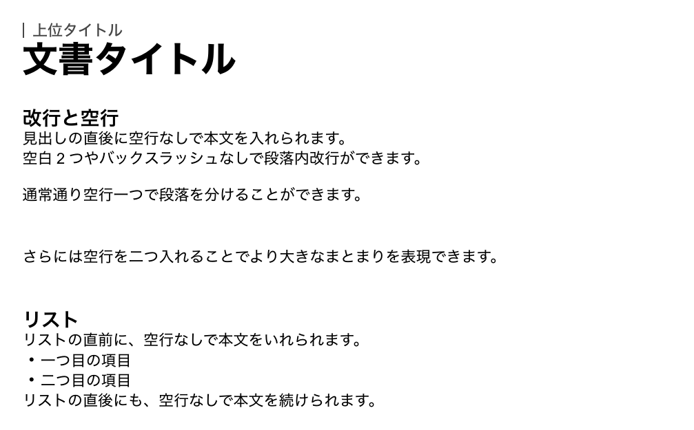

# Staccarta Preview
[記法ガイド](https://github.com/asagi-dyce/staccarta/blob/main/syntax.md) · [markdownlint設定ガイド](https://github.com/asagi-dyce/staccarta/blob/main/markdownlint.md) · [ロードマップ](https://github.com/asagi-dyce/staccarta/blob/main/roadmap.md)

Staccarta PreviewはCommonMark系拡張機能です。

Markdown原稿をプレビューし、PDF・HTMLで保存できます。
通常のMarkdownとは改行・空行の扱いが少しだけ異なります。

現在はα版です。

## プレビュー
`.md`または`.stca`の原稿を開き、エディター右上のStaccartaアイコンを押します。コマンドパレットの「Staccarta: PDFプレビューを開く」からも表示できます。

編集内容は保存前でも自動で反映されます。プレビュー右上のボタンでPDF表示とHTML表示を切り替えられます。

## PDF・HTMLで保存する
原稿を右クリックし、「Staccarta: PDFで出力」または「Staccarta: HTMLで出力」を選び、保存先を指定します。プレビューを開く必要はありません。

PDF生成には、同梱のTypstを使用します。

## 原稿も読みやすく
より読みやすいmdコードを書きましょう。

StaccartaはPDF、HTML、そしてソースコードさえも読みやすい、日本語文書向けの軽量マークアップ言語です。

```text
上位タイトル
文書タイトル
===

### 改行と空行
見出しの直後に空行なしで本文を入れられます。
空白2つやバックスラッシュなしで段落内改行ができます。

通常通り空行一つで段落を分けることができます。


さらには空行を二つ入れることでより大きなまとまりを表現できます。


### リスト
リストの直前に、空行なしで本文をいれられます。
- 一つ目の項目
- 二つ目の項目
リストの直後にも、空行なしで本文を続けられます。
```

### 出力例


## Markdownとの関係
CommonMark系のMarkdown記法を基礎とし、`.md`ファイルを入力できます。Staccarta向けに書いた`.md`も、既存のMarkdownエディターやCommonMark系のプレビューで利用できます。ただし、改行・余白や一部の文書構造の表示は異なります。

`.md`では既存のMarkdown編集支援を利用できます。専用拡張子の`.stca`では、Staccartaのリスト入力補助・アウトライン・構文チェックを利用できます。

markdownlintを使用する場合は、空行や見出しなどの検査ルールをStaccarta向けに調整してください。

## AIで原稿を書く
新規の`.md`原稿を基本的にStaccartaで作成したい場合は、ルールを保存できるAIエージェントへ次の文を渡してください。

> 次のルールを登録してください。  
> 新規の`.md`原稿は、別の指定がなければStaccarta記法で作成する。  
> Staccarta原稿の作成・編集時は、https://github.com/asagi-dyce/staccarta/blob/main/ai-guide.md を読んで従う。

ルールを保存できないチャットでは、原稿を依頼する時にガイドのリンクも渡してください。

## 設定
PDFプレビューの待ち時間を短くするため、原稿を開いた時にTypstを先行準備します（メモリ使用量が増えます）。不要な場合は、設定の「Staccarta: Prewarm Typst」をオフにしてください。

## 対応環境と制限
Windows x64・macOS Intel・macOS Apple Silicon向けです。Apple Silicon版は実機未確認の試験対応です。

CommonMarkの全機能には対応しておらず、画像・引用などは未対応です。

## 問題報告
不具合や要望は、asagi.dyce@gmail.comへお寄せください。不具合の場合は、OS・VS Code・Staccartaのバージョンと、問題が起きる原稿例を添えてください。原稿例には機密情報や個人情報を含めないでください。

## ライセンス
作者：浅葱賽子（Asagi Dyce）。Staccartaの自作部分はMITライセンスです。同梱ソフトウェアのライセンスは、拡張機能フォルダーの`LICENSE`、`THIRD-PARTY-NOTICES.txt`と`runtime`内のライセンス通知に収録しています。
